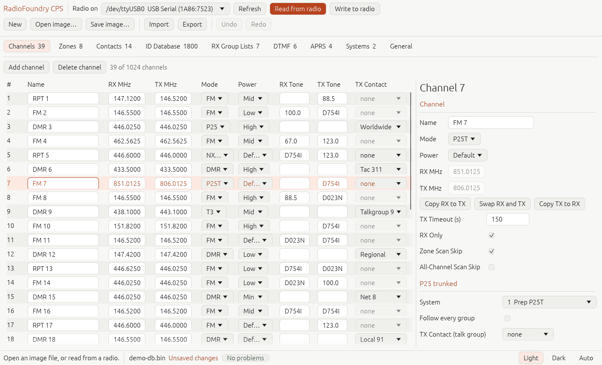
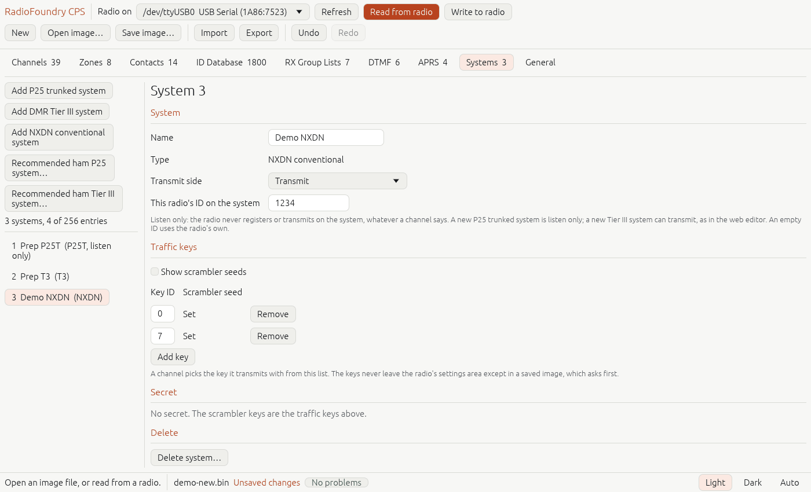
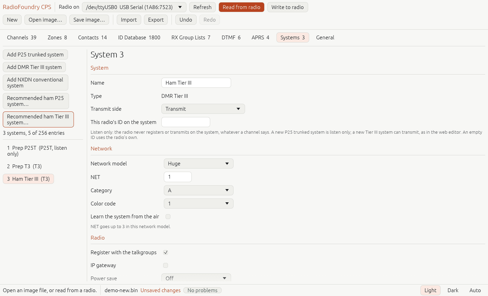
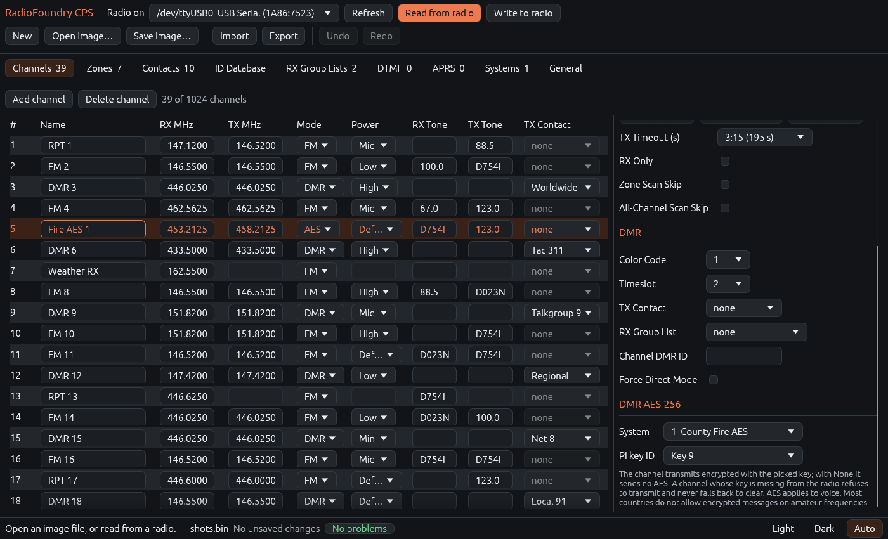
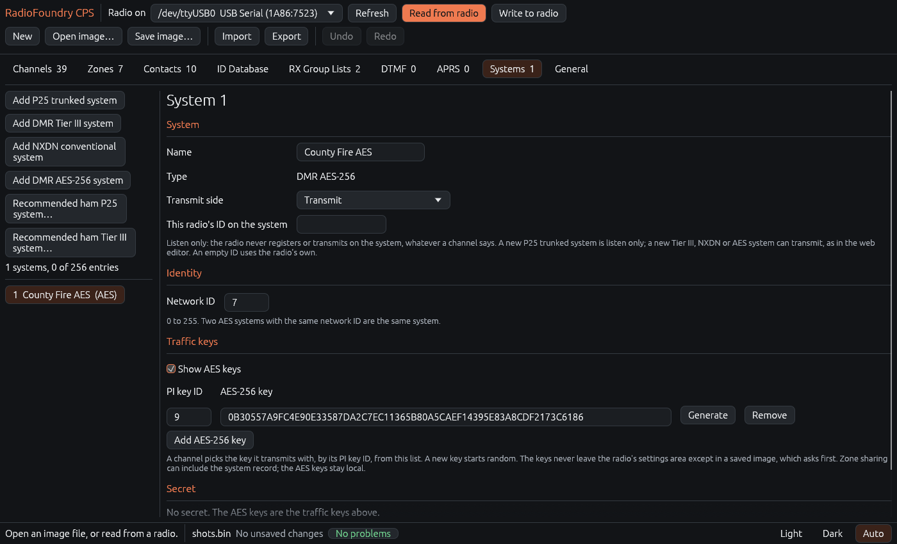
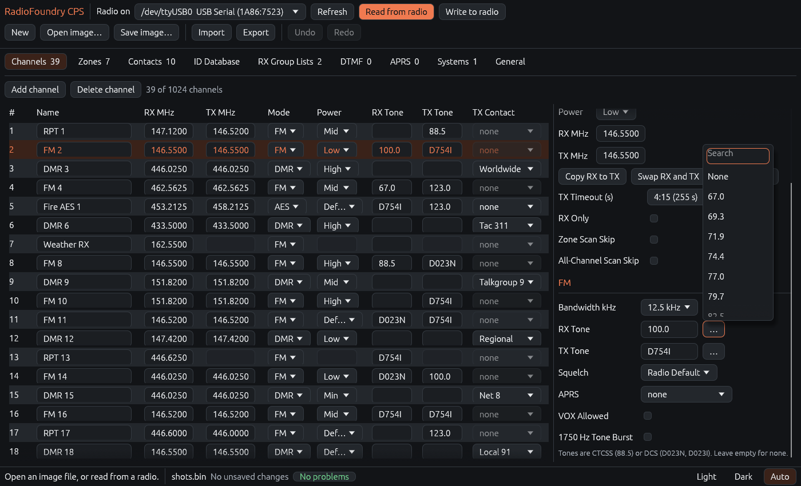
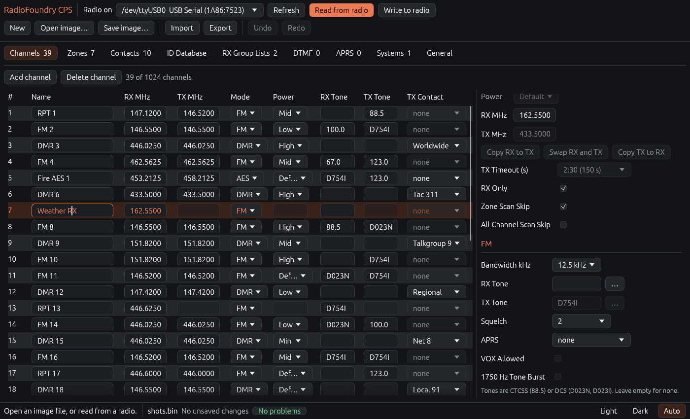

# RadioFoundry CPS (Rust)

A native codeplug editor for [RadioFoundry](https://github.com/RadioFoundry/RadioFoundry) radios, written in Rust: a
Windows 11 `.exe` and a Linux program, no browser. First radio: the DM-32UV.

An independent editor, not an official RadioFoundry release. MIT licensed. Anything ported from RadioFoundry keeps its
notice (see `LICENSE`, `AUTHORS`, `CONTRIBUTORS` and `NOTICE.md`).

**Tested on one radio:** the DM-32UV, on Windows 11 and Linux. Other RadioFoundry radios may work, since RadioFoundry's spec says the protocol and the
image layout are shared, but none has been tried; see [Adding a radio](docs/adding-a-radio.md). Version 0.5.3 was
checked on Linux, including a real write (a test channel, zone, contacts, RX group list and boot text added, removed
and the backup restored, ending byte for byte as it began); 0.5.4 changes only the width of one box on the screen.
Windows was not checked again for 0.5.3 or 0.5.4.

## Download

Get the [latest release](https://github.com/insideTheFlux/radiofoundry-cps/releases/latest): `rfcps-*-linux-x86_64.tar.gz`
and `rfcps_*_amd64.deb` for Linux, `rfcps-*-windows-x86_64.zip` for Windows 11 (unsigned, so SmartScreen asks once).
What changed in each version is in [CHANGELOG.md](CHANGELOG.md). It keeps pace with RadioFoundry's web Codeplug Editor;
each release's notes say which RadioFoundry commit it matches (0.5.4: `dd67ecd6`).

## What it does

- Reads a radio's codeplug over its programming cable or USB (the fast codeplug protocol), in under a second.
- Edits channels, zones, contacts, RX group lists and the general settings (including the settings area: ARS server, IP gateway, tones and signaling tones), P25 and NXDN conventional channels (mode, NAC or RAN, squelch, rate, an NXDN channel's system and transmit key) and the P25 and NXDN unit IDs, P25 trunked systems (identity, sites, control channels, channel plan; listen only until you turn the transmit side on), DMR Tier III systems (network, options, fixed plan, channels, key) NXDN conventional systems (scrambler keys, shown only when asked) with channels on them, and DMR AES-256 channels and systems (a PI key ID per channel; the AES keys, shown only when asked, each started random or filled by Generate), the recommended ham P25 and Tier III systems from a site's control channel, Accept Invalid CRC, names in Chinese (three bytes a character), DTMF contacts and APRS configurations, with undo, a Problems list (the web editor's
  checks) and the web editor's look, light or dark. On a receive-only channel the transmit fields are grayed; tone
  fields have a searchable list of the CTCSS tones and DCS codes, and the TX timeout is a list.
- Builds the DMR ID database from a RadioID `user.csv` (downloaded here on a button, fetched for a few regions through RadioID's API, or opened from a file; the choices are kept in `~/RadioFoundry-CPS/id-database-settings.json`, never the API key; regions, call
  sign prefixes, name templates), or adds those users as contacts; the database is sent in its own step after the
  codeplug. The download is the only network use: one request to radioid.net, and only when you press the button. A
  database whose header the editor cannot read is shown and can be removed; one that is too big for the radio's image
  is flagged before a write, and **Cut to fit** keeps the records that fit.
- Writes to the radio safely: a list of what will change, a backup of the radio's codeplug first, only the changed
  blocks, a refusal if the radio changed since it was read, and a read-back check.
- Imports a stock DM-32UV backup (the web installer's `.zip`), qdmr YAML codeplugs, CHIRP CSV and CSV tables; exports qdmr YAML, CSV tables and CHIRP CSV. A qdmr file carries the systems and channel modes in a `radioFoundry` block that qdmr ignores (keys are never written).
  CSV, CHIRP and qdmr files are the web editor's: they work in both editors.

## Screenshots

Most were taken with version 0.5.1; the four showing DMR AES-256, the tone list and the grayed transmit fields were taken
with 0.5.4. All use an invented test image (no real radio, call signs, names or keys).


















## Screen readers

The program publishes every control to screen readers (AccessKit: UI Automation on Windows, AT-SPI on Linux), with a
name on each table cell and field ("RX MHz, channel 5"). Listened to with Narrator on Windows 11 using the keyboard: the
tables, drop-downs, check boxes, menus, dialogs and tabs all work, and adding and deleting a channel works. Use Tab and
the arrow keys; a mouse click on a drop-down is not announced. Also tried with Orca on Ubuntu (GNOME): drop-downs, menus, dialogs and check boxes work. If
the focus ever leaves a check box after you toggle it (seen once on Windows, not reproduced), Tab back to it and tell us. Tell us what you find.

## Run

```
cargo run -p rfcps            # the editor
cargo test --workspace        # the tests (no radio needed)
```

Without a window: `rfcps --ports` lists serial ports (a likely radio cable is marked: FTDI, CH340, CH9102, CP210x, Prolific, the RT Systems USB-K4Y and the open-firmware radios' own USB serial), `rfcps --read PORT out.bin` saves the radio's codeplug to a file (read only), `rfcps --help` shows the rest.

On Linux, to use a serial port add your user to the `dialout` group (`sudo usermod -aG dialout $USER`) and log in again.

If the radio's cable does not appear as a port at all (no `/dev/ttyUSB0` when it is plugged in), some Ubuntu versions run `brltty`, a braille-display service that takes over USB serial cables with the CH340 chip; removing it (`sudo apt remove brltty`) brings the port back. This has not been tried on a fresh install here, so treat it as a known cause, not a certain one. A screen reader user who needs `brltty` should leave it installed and check `dmesg` for what claimed the cable.

On a Wayland desktop (the Ubuntu default) the window runs on X11 through XWayland, so the desktop draws its normal title
bar and buttons (a native Wayland window gets a plain frame there). `RFCPS_WAYLAND=1 rfcps` keeps native Wayland.

## Packages

| Platform | How |
|---|---|
| Linux (Ubuntu, Debian) | `packaging/build-linux.sh` makes `dist/*.tar.gz` and `dist/*.deb`; the tarball has an `install.sh` (per user, or `PREFIX=/usr/local sudo ./install.sh`; `./install.sh uninstall` removes it) |
| Windows 11 | on a Windows computer with Rust and the Visual Studio C++ Build Tools: `powershell -ExecutionPolicy Bypass -File packaging\build-windows.ps1` makes `dist\*.zip` with `rfcps.exe` |
| Both | `.github/workflows/release.yml` builds and tests both on GitHub when it is run, or when a `v*` tag is pushed |

Windows: the radio's cable needs its serial driver (FTDI or CH340); Windows 11 usually installs it by itself. An unsigned
program makes SmartScreen ask "Run anyway?" once.

## Layout

| Crate | Holds |
|---|---|
| `rfcps-core` | the codeplug as data: the image format, validation, diff, CSV, CHIRP, qdmr YAML and the stock DM-32UV import. No I/O |
| `rfcps-link` | the serial link: the debug link's frames, the fast codeplug read and write, and a software radio for tests |
| `rfcps` | the window |

See `PLAN.md` for scope and status, `docs/testing.md` for how the tests work (and `tools/webcompare/` to check the parity
with the web editor yourself), and `docs/adding-a-radio.md` for trying another radio.
